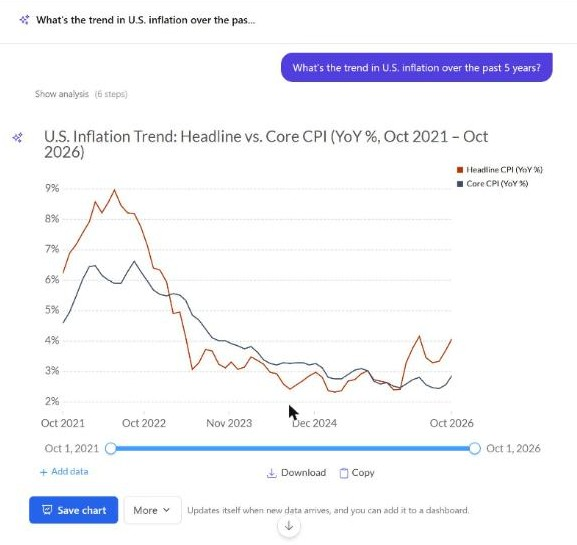

Alphacast AI is a chat assistant for economic and financial data. It can search for data, read it, run calculations, and answer with text, a chart, a table, or an [AI View](/ai/views). It can also answer questions about how to use Alphacast, using these docs.

## Ask a question

<Steps>
  <Step title="Open the assistant">
    Click **Alphacast AI** in the left menu. You can also ask from **Home**, or click **Analyze with AI** on a dataset page.
  </Step>
  <Step title="Choose the data scope">
    A new chat in **Alphacast AI** starts with **All Alphacast**.
  </Step>
  <Step title="Write your question">
    Say what you want: the indicator, the country or entity, the period, the calculation, and the format. For example: `Compare annual inflation in Chile and Peru since 2019 in a line chart.`
  </Step>
  <Step title="Refine it">
    Continue in the same chat: change the period, add a series, or ask for another format.
  </Step>
</Steps>

<Frame>
  
</Frame>

## Choose what the assistant can search

| Scope | What it covers |
|---|---|
| **All Alphacast** | Alphacast data, plus external data providers and market tickers. |
| Your team's name | Your team's data. Shown in a team workspace. |
| **My Clipped Datasets** | The datasets in your [Clips](/clips). Shown when you have at least one. |
| **Specific Repository** | A repository you choose, including its [files](/your-data/files). |

The narrower scopes don't use external providers or tickers. A chat started from a dataset page focuses on that dataset.

What the assistant can read depends on your [plan](https://www.alphacast.io/pricing) and permissions. Finding a dataset doesn't guarantee that you have access to its data.

## Check the answer

AI answers can be wrong. Before you rely on one:

- Click **Show analysis** to see the steps the assistant took.
- When an answer shows a source count, click it to see what the assistant used, such as datasets, series, tickers, or external providers.
- When a result offers **View Data** or **Show Code**, use them to inspect it.
- Check dates, units, frequency, and entities.

Answers based on repository files can include citations that point to the files.

You can also copy a response, regenerate it, or rate it as a good or bad response.

## Save results

| Result | Main button |
|---|---|
| Chart | **Save chart** |
| Table | **Save table** |
| Data | **Save as dataset** |
| AI View | **Save view** |

For charts and tables, **More** can also offer **Publish the data as a dataset**. When available, **Download data (CSV)** downloads the data.

You choose a repository when you save. Alphacast creates a [pipeline](/steps/overview) that repeats the steps behind the result, so it can update with new data. A new dataset published this way appears when the pipeline's first run finishes. Use **See the steps** or **Open pipeline** to review it.

<Note>
  Saving requires a plan that can create content. Free and Explorer can't save results. Results built on data that you can view but not download can't be saved, published, or downloaded.
</Note>

## Work with pipelines from the chat

Alphacast AI can read your pipelines. If you can create content in your workspace, it can also create and change them. Review each change, then click **Approve** or **Reject**. See [build pipelines with AI](/pipelines/build-with-ai).

## Provider API keys

If an external provider needs a key, the chat can ask for it. Paste it, click **Save Key**, and retry your request. See [provider API keys](/explore/api-explorer#add-a-provider-api-key).

## Your conversations

Your chats are listed under **Conversations**, next to the chat. Click **New chat** to start another.

## Limits

Each [plan](https://www.alphacast.io/pricing) sets how much you can use the AI and which data it can access. To use Alphacast data in Claude, ChatGPT, or another assistant, see [AI assistants](/connect/assistants).

## Next steps

<CardGroup cols={2}>
  <Card title="AI Views" icon="chart-line" href="/ai/views">
    Create mini dashboards from a prompt.
  </Card>
  <Card title="Agents" icon="robot" href="/ai/agents">
    Give your team an assistant with a defined scope.
  </Card>
</CardGroup>
