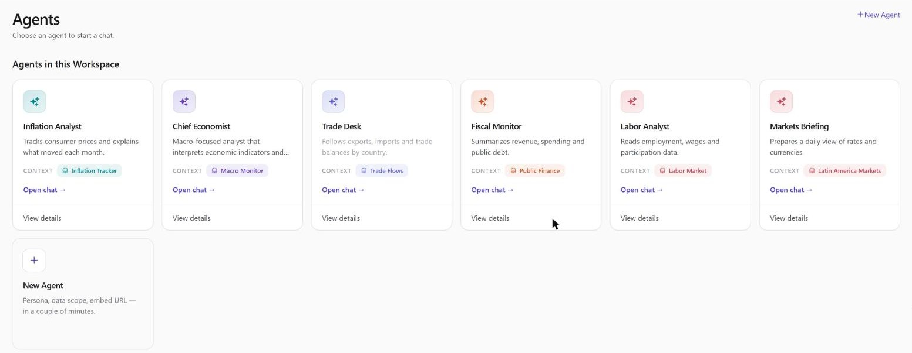

An agent is an AI assistant set up for a specific purpose. It has its own name, instructions, starter prompts, and data scope. For general questions, use [Alphacast AI](/ai).

## Chat with an agent

<Steps>
  <Step title="Open Agents">
    In the Alphacast AI conversation list, click **Agents**, or open [alphacast.io/ai/agents](https://www.alphacast.io/ai/agents).
  </Step>
  <Step title="Choose an agent">
    Agents are listed under **Agents in this Workspace** and, in some workspaces, **Alphacast agents**.
  </Step>
  <Step title="Start the chat">
    Open the agent's chat, then type a question or pick a starter prompt. **View details** shows more about the agent.
  </Step>
</Steps>

You need access to an agent to use it. Agents you use often can appear under **Frequent agents**.

<Frame>
  
</Frame>

## Before you create an agent

You need:

- A plan that can create content. See [pricing](https://www.alphacast.io/pricing).
- **Admin** permission on a team repository. Agents can only be created in team repositories. See [workspaces](/workspaces).

## Create an agent

<Steps>
  <Step title="Start">
    On the **Agents** page, click **New Agent**.
  </Step>
  <Step title="Describe it">
    Enter a **Name**, choose a **Repository**, and answer **What is this agent for?** Click **Generate** to get a draft, or **I'll write the prompt myself**.
  </Step>
  <Step title="Review it">
    Edit the **Description**, **System prompt**, **Welcome message**, and **Starter prompts**.
  </Step>
  <Step title="Create">
    Click **Create and edit** to continue to the agent's settings.
  </Step>
</Steps>

## Configure an agent

| Tab | What you set |
|---|---|
| **Identity** | Basic information and logo. |
| **Behavior** | System prompt, welcome message, input placeholder, example prompts, and language (**Detect**, **English**, **Spanish**, or **Portuguese**). You can also restore a previous version of the configuration. |
| **Data & Access** | Which data the agent can search. |
| **Embed & Style** | Options to use the agent on another site. See [embeds](/connect/embeds). |

Click **Save changes** when you finish.

### Set the data scope

Choose one **Scope**:

- **Current Repository Datasets**: the datasets in the agent's repository.
- **Specific Datasets**: a list you choose. Add dataset IDs, or drag datasets from your [Clips](/clips).

Under **Additional data sources**, you can turn on **Alphacast Official Datasets**, **FRED Economic Data**, and **Financial Tickers**. Check these settings after you create the agent. The files in the agent's repository are always available to it.

<Tip>
  In the system prompt, say what the agent should help with, which data it should prefer, and what to do when it can't answer. Then test it with the questions your team asks most.
</Tip>

## Manage agents

Admins of a team repository can see its agents in the repository's **Agents** tab. If you can edit an agent, **View details** has an **Options** menu with **View conversations** and **Edit**.

<Note>
  People who manage an agent can view its conversations. Let your users know.
</Note>

## Limits

You can't create or edit pipelines from an agent chat. Use [Alphacast AI](/ai) for that. Some other options in an agent chat can also differ. Embedding an agent requires the [Workspace plan](https://www.alphacast.io/pricing).

## Next steps

<CardGroup cols={2}>
  <Card title="Add files for your agent" icon="file" href="/your-data/files">
    Upload documents to the agent's repository.
  </Card>
  <Card title="Embed an agent" icon="code" href="/connect/embeds">
    Offer it on your own site.
  </Card>
</CardGroup>
