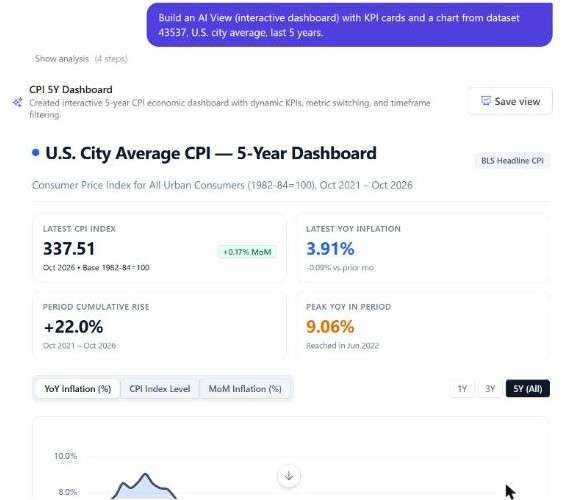

An AI View is a custom visualization that Alphacast AI builds for your question. Use it when one chart or table isn't enough: KPI cards, linked charts, custom interactions, or a richer report layout. For a simple chart or table, just ask for a chart or a table. See [charts](/charts).

## Create a view

<Steps>
  <Step title="Ask for it">
    In [Alphacast AI](/ai), describe the view. For example: `Create an AI View of inflation in Brazil with KPI cards for the latest values and a chart of the last five years.`
  </Step>
  <Step title="Answer follow-up questions">
    The assistant can offer options. Choose one or describe what you prefer.
  </Step>
  <Step title="Refine it">
    Ask for changes in the same chat, such as `Add a table below the chart` or `Show quarterly values`. Say so if you also want to change the data.
  </Step>
  <Step title="Check it">
    Compare key numbers with the source data before you use or share the view.
  </Step>
</Steps>

The assistant can also choose an AI View on its own when it fits your question. If a view fails to display, Alphacast tries one automatic repair. If it still fails, ask the assistant to fix it.

<Frame>
  
</Frame>

## Save a view

<Steps>
  <Step title="Click Save view">
    The button becomes available after the view displays and passes validation.
  </Step>
  <Step title="Choose a repository">
    Alphacast creates a [pipeline](/steps/overview) with the view and opens it.
  </Step>
  <Step title="Go back to it">
    In the chat, use **Open view** when it is shown, or **See the steps** to open the pipeline.
  </Step>
</Steps>

A saved view can update when its pipeline runs again with new data. See [pipeline runs](/pipelines/runs).

Saving requires a plan that can create content. See [pricing](https://www.alphacast.io/pricing). You also can't save a view built on data that you can view but not download.

## Use a saved view

Saved views appear in the repository's **Views** tab. The view page offers these actions. Some depend on your sign-in and permissions.

| Action | What it does |
|---|---|
| **Clip** | Adds the view to your [Clips](/clips). After clipping, you can add it to a dashboard. |
| **Share** | Opens the sharing options. See [sharing](/sharing). |
| **Edit** | Opens the pipeline step that defines the view. |
| **View source** | Opens the pipeline behind the view. |

The page can also list the view's **Sources**.

Check who can access a view before you share it. If you add a private view to a public dashboard, Alphacast asks you to confirm. To publish views on your own site, see [embeds](/connect/embeds). Embedding requires the [Workspace plan](https://www.alphacast.io/pricing).

## Build views in a pipeline

You can also create a view in a pipeline with the [AI Visualization step](/steps/ai-visualization).

## Next steps

<CardGroup cols={2}>
  <Card title="Dashboards" icon="table-cells-large" href="/dashboards">
    Combine views, charts, and text.
  </Card>
  <Card title="Sharing" icon="share-nodes" href="/sharing">
    Control who can see your work.
  </Card>
</CardGroup>
