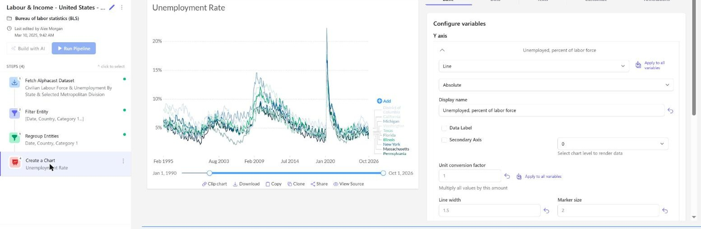

A chart in Alphacast is built by a [pipeline](/steps/overview). The pipeline gets the data and a [chart step](/steps/chart-data) draws it. When the pipeline runs with new data, the chart updates.

Creating charts requires a [plan](https://www.alphacast.io/pricing) that lets you save content.

<Frame>
  
</Frame>

## Create a chart

<Steps>
  <Step title="Start the chart">
    Click **Create new**, then **Chart**. Alphacast creates a pipeline with a chart step in your [working repository](/concepts/repositories#choose-your-working-repository) and opens the editor.
  </Step>
  <Step title="Add the data">
    Add a step before the chart step to bring in data, for example [Fetch dataset](/steps/fetch-dataset). Add filters or transformations if you need them.
  </Step>
  <Step title="Configure the chart">
    In the chart step, choose the **Chart Type**, select the columns and adjust the chart. See [Chart data](/steps/chart-data) for the options.
  </Step>
  <Step title="Save">
    Save the step and check the result.
  </Step>
</Steps>

You can also ask [Alphacast AI](/ai) to chart data, or [build pipelines with AI](/pipelines/build-with-ai).

## Find your charts

Open a repository and go to the **Views** tab. Click a chart to open its page, which also lists its **Sources**.

## Work with a chart

Open the menu on a chart card:

| Action | What it does |
| --- | --- |
| **Share** | Copy or post the link, or get [embed code](/connect/embeds) |
| **Clip** | Save the chart to your [clips](/clips) so you can add it to a dashboard |
| **Edit** | Open the pipeline step behind the chart. Shown if you have write access |
| **Delete** | Remove the chart step. Shown if you have write access |

To clip several charts, hold `Ctrl` (`Cmd` on Mac) while you click them, then click **Clip Charts**.

After you clip a chart, you can click **Add to a dashboard** in the confirmation message.

## Apply a chart theme

A theme sets the visual style of the charts in a repository.

1. Open the repository and go to **Settings**.
2. Under **Chart Theme**, select a theme. Click **New** to create one or **Edit** to change the selected one.
3. Click **Save**.

You need access to the repository settings, and the option may not appear for every account. Themes and branding depend on your [plan](https://www.alphacast.io/pricing).

## Keep charts current

A chart shows the output of its pipeline. Check [pipeline runs](/pipelines/runs) to see when the data was last processed.

## Next steps

<CardGroup cols={2}>
  <Card title="Dashboards" icon="table-cells-large" href="/dashboards">
    Combine charts on one page.
  </Card>
  <Card title="Chart data step" icon="chart-line" href="/steps/chart-data">
    See how to configure charts.
  </Card>
</CardGroup>
