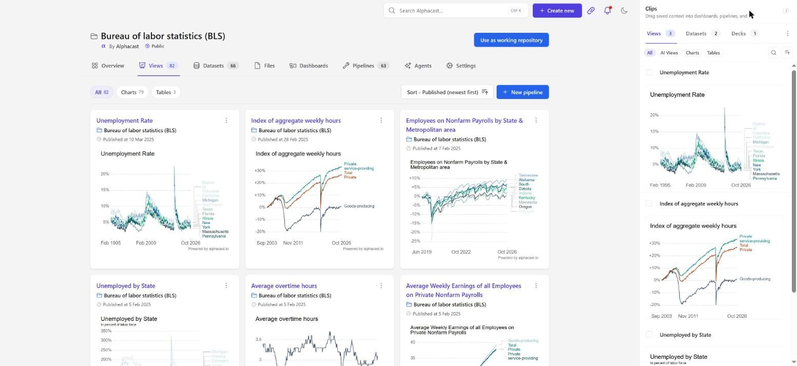

Clips is your shortlist. Clip something useful, then open it later or drag it into your work. Your clips belong to you, and each workspace has its own list.

A clip points to the original item. To keep a result from an AI chat, [save it first](/ai#save-results).

## Clip something

| Item | How to clip it |
|---|---|
| Dataset | On the dataset page, click **Clip Dataset**. The button appears when you have full access to the data and the dataset isn't deprecated. |
| Chart | Use the clip option on the chart, or **Clip** in the chart's menu in a chart list. |
| Table | Click **Clip table**. |
| AI View | Click **Clip** on the view page or in its menu. |

Some pipeline outputs also have a clip button.

## Open your clips

<Steps>
  <Step title="Open the panel">
    Click the paperclip icon in the header.
  </Step>
  <Step title="Choose a tab">
    Clips are grouped in tabs such as **Views**, **Datasets**, **Decks**, and **AI Summaries**. Some tabs appear only when they have content. In **Views**, you can filter by **AI Views**, **Charts**, or **Tables** when you have them.
  </Step>
  <Step title="Find a clip">
    Search by title, or sort by **Latest clipped**, **First clipped**, or title. Click a clip to open it.
  </Step>
</Steps>

<Frame>
  
</Frame>

## Reuse clips

- **Dashboards**: drag charts, tables, or AI Views into a dashboard you are editing. See [dashboards](/dashboards).
- **Pipelines**: drag a dataset onto a dataset field in a step. See [pipelines](/steps/overview).
- **Agents**: when an agent uses **Specific Datasets**, drag datasets from your clips into the list. See [agents](/ai/agents).
- **Alphacast AI**: when you have clipped datasets, choose **My Clipped Datasets** as the data scope to focus a new chat on them. See [data scope](/ai#choose-what-the-assistant-can-search).

To move several datasets or views at once, select them and drag the selection.

## Remove clips

Open a clip's menu and click **Remove clip**. To remove several, select them and click **Remove**. This removes them from your clips. It doesn't delete the original items.

## Next steps

<CardGroup cols={2}>
  <Card title="Build a dashboard" icon="table-cells-large" href="/dashboards">
    Arrange your views on one page.
  </Card>
  <Card title="Ask about your clips" icon="sparkles" href="/ai">
    Use your shortlist as the assistant's data.
  </Card>
</CardGroup>
