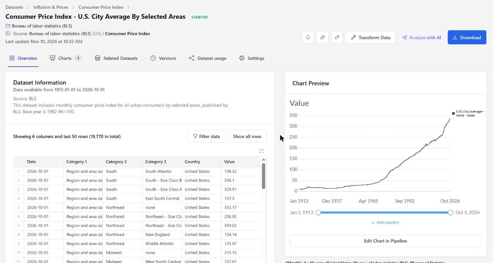

A dataset is a table of data that lives in a [repository](/concepts/repositories). To find one, see [Explore](/explore).

## How a dataset is structured

| Part | What it is |
|---|---|
| Date column | When each observation applies. |
| Entity columns | What each row describes, such as a country or a sector. The date is also one of the columns that identify a row. |
| Variables | The values themselves, such as an index or an amount. |

## Check what the dataset contains

The top of the page can show the dataset name, repository, source, publication, and **Last update**. If a pipeline or another dataset produced it, the page can say so.

**Dataset Information** shows the dates covered, and the source and description when available. Click **Show more** to read a long description.

<Warning>
  Read any **Dataset Deprecated** notice before you use the data. If the notice names a replacement, click **Switch to new dataset**.
</Warning>

<Frame>
  
</Frame>

## Preview and filter data

The preview table shows the most recent rows first. Values in the preview can be rounded.

<Steps>
  <Step title="Open the filters">
    Click **Filter data**.
  </Step>
  <Step title="Choose what to keep">
    Set a date range, pick entity values such as countries, and select variables.
  </Step>
  <Step title="Apply">
    Click **Apply Filters**. The filters also apply to the chart preview and to downloads.
  </Step>
</Steps>

If you see **Data Preview**, your access includes only a sample. The table and chart can omit rows and periods.

A chart preview isn't available for every dataset. It needs numeric variables, and it can be unavailable when you select many variables or the dataset has many entity columns. Select fewer variables, or filter or group entities with a [pipeline](/steps/overview).

## Page tabs

| Tab | What it shows | Notes |
|---|---|---|
| **Overview** | Information, data table, and chart preview. | |
| **Charts** | Charts published with this data. | Sign in to browse them. |
| **Related Datasets** | Datasets related to this one. | |
| **Versions** | Data versions and activity. With more than one version, you can **Compare Versions**. | Shown when signed in. |
| **Dataset usage** | Where the dataset is used. | Repository admins only. |
| **Settings** | Dataset configuration. | People who can edit the repository. |

## Dataset actions

The actions you see depend on your sign-in, plan, permissions, and the dataset. On small screens, some are under **More dataset actions**.

| Action | What it does |
|---|---|
| **Analyze with AI** | Opens [Alphacast AI](/ai) focused on this dataset. |
| **Download** or **Download preview** | Opens the **Use this data** panel. |
| **Subscribe** | Notifies you when a new version is available. Requires full access to the dataset's data. Click **Unsubscribe** to stop. See [notifications](/notifications). |
| **Clip Dataset** | Saves it to your [Clips](/clips). Requires full access to the dataset's data. |
| **Transform Data** | Creates a [pipeline](/steps/overview) that starts from this dataset. Requires a plan that can create content. |
| **Upload data** | Adds data to a dataset you can edit. Not shown when a connection or a pipeline updates it. See [your datasets](/your-data/datasets). |
| **Sync Now** | Requests an update from the connected source, when the dataset supports it. |

Deprecated datasets don't offer **Subscribe**, **Clip Dataset**, or **Transform Data** in the page header.

## Use this data

The **Use this data** panel has two parts:

- **Download**: choose XLSX, CSV, JSON, or TSV, or click **Copy Link**. XLSX isn't offered when the data is too large for a spreadsheet. Turn on **Dates as columns** to transpose XLSX, CSV, or TSV, or **Include Variable IDs** to add column IDs.
- **Connect data**: follow the steps for [AI assistants](/connect/assistants), [Excel](/connect/excel), [Google Sheets](/connect/google-sheets), or [Python](/connect/python).

Your [plan](https://www.alphacast.io/pricing) sets which data you can download in full and how much you can download each month. When you reach your limit, the page can show **Download limit reached**.

<Warning>
  Download links and code from this panel can contain your API key. Treat them as private.
</Warning>

## Work with datasets from code

To manage datasets programmatically, use the API reference: [list datasets](/api/datasets/list), [get a dataset](/api/datasets/get), [rename or move](/api/datasets/get#rename-or-move-a-dataset), [get columns](/api/datasets/columns), [create](/api/datasets/create), [upload data](/api/datasets/upload), [download data](/api/datasets/data), and [delete](/api/datasets/delete).

## Next steps

<CardGroup cols={2}>
  <Card title="Ask about this data" icon="sparkles" href="/ai">
    Summarize, chart, transform, or compare.
  </Card>
  <Card title="Connect your tools" icon="plug" href="/connect">
    Use the data where you work.
  </Card>
</CardGroup>
