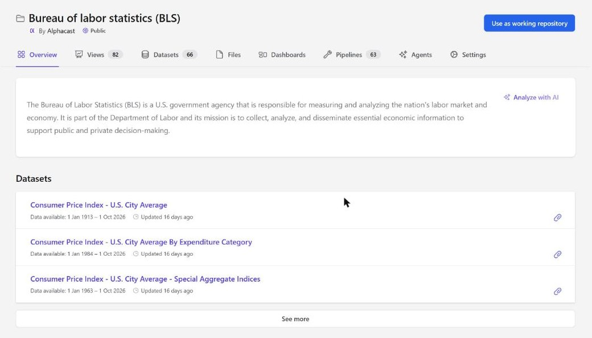

A repository is where you keep your work in Alphacast. What you create is saved in a repository. Each one belongs to a [workspace](/workspaces) and has its own privacy setting and members.

<Frame>
  
</Frame>

## Create a repository

<Steps>
  <Step title="Start a new repository">
    Click **Create new**, then **Repository**.
  </Step>
  <Step title="Describe it">
    Check the **Owner**, which is your current workspace. Fill in **Repository Name** and **Description**.
  </Step>
  <Step title="Choose the privacy">
    Select **Public access** or **Private to Repository Members**. Whether you can create a private repository depends on your plan.
  </Step>
  <Step title="Create it">
    Click **Create repository**.
  </Step>
</Steps>

## Choose your working repository

Your working repository is the default place for new work. To change it, open a repository in your current workspace and click **Use as working repository**. You need write access.

You can also change it from the **Create new** menu with **Change**. Some actions, such as **Transform Data** on a dataset, ask where to save the result without changing your working repository.

## What is inside a repository

| Tab | What you find |
| --- | --- |
| **Overview** | The description and a summary of the content |
| **Views** | [Charts](/charts), tables and [AI Views](/ai/views) |
| **Datasets** | Datasets, including [the ones you upload](/your-data/datasets) |
| **Files** | [Documents](/your-data/files) that Alphacast AI can search |
| **Dashboards** | [Dashboards](/dashboards) |
| **Pipelines** | [Pipelines](/steps/overview) that build and update data |

You see a content tab when it has content or when you can add content to it. Some repositories show other tabs, depending on your role.

## Privacy

| Setting | Who can see the repository |
| --- | --- |
| **Public access** | Anyone who has the link |
| **Private to Repository Members** | Only members of the repository |

Only the **Owner** can make a private repository public. An **Admin** or the **Owner** can make a public repository private. If public dashboards use content from that repository, Alphacast warns you before you save, because their readers may lose access to it.

## Permission levels

| Permission | What it is for |
| --- | --- |
| **Read** | View the content |
| **Clone** | Also copy content to a repository where you can write |
| **Write** | Also create and edit content |
| **Admin** | Also manage members and repository settings |
| **Owner** | Also delete or transfer the repository, make it public, and set clone restrictions |

To add people, see [Sharing](/sharing).

## Repository settings

Admins see a **Settings** tab. Your personal home repository does not have one.

- **Repository Name** and **Description**.
- **Chart Theme**: the style for [charts](/charts#apply-a-chart-theme) in this repository.
- **Privacy**. The **Owner** can also require clone access to see and clone pipelines, or to clone dashboards.
- **Repository Access**: [members and invitations](/sharing).
- **AI File Processing** and **External Sync Sources**: see [Files](/your-data/files) and [Sync](/your-data/sync).
- **Danger Zone** (Owner only): transfer ownership or delete the repository.

<Warning>
  Deleting a repository cannot be undone.
</Warning>

## Manage repositories with code

See the API reference to [list](/api/repositories/list), [create](/api/repositories/create), [update](/api/repositories/update) and [delete](/api/repositories/delete) repositories, or use the [Python SDK](/python-sdk/repositories).

## Next steps

<CardGroup cols={2}>
  <Card title="Share a repository" icon="user-plus" href="/sharing">
    Invite people and set their permissions.
  </Card>
  <Card title="Upload your data" icon="upload" href="/your-data/datasets">
    Create a dataset from your own spreadsheet.
  </Card>
</CardGroup>
