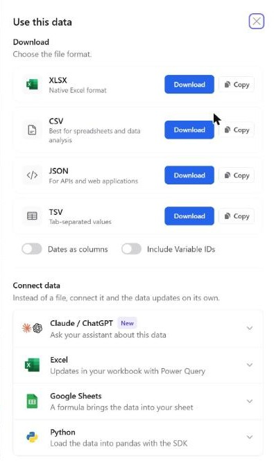

Once you have the data you need, connect it to your own tools. A connection can fetch updated data, so you do not need to download a new file each time.

## Choose a connection

<CardGroup cols={2}>
  <Card title="Claude and ChatGPT" icon="sparkles" href="/connect/assistants">
    Ask your assistant about Alphacast data.
  </Card>
  <Card title="Excel" icon="file-excel" href="/connect/excel">
    Load data with a link and refresh your workbook.
  </Card>
  <Card title="Google Sheets" icon="table" href="/connect/google-sheets">
    Bring data into a sheet with a formula.
  </Card>
  <Card title="Python" icon="python" href="/connect/python">
    Load data into pandas with the SDK.
  </Card>
  <Card title="MCP" icon="plug" href="/mcp/overview">
    Connect coding agents and other MCP clients.
  </Card>
  <Card title="REST API" icon="code" href="/quickstart">
    Integrate Alphacast with your own code.
  </Card>
  <Card title="Webhooks" icon="bolt" href="/connect/webhooks">
    Notify a URL when data changes or an alert triggers.
  </Card>
  <Card title="Embeds" icon="window-maximize" href="/connect/embeds">
    Show charts, dashboards and AI Views on a web page.
  </Card>
</CardGroup>

## Connect from a dataset page

The fastest way to start is from the data itself.

<Steps>
  <Step title="Open the dataset">
    [Find a dataset](/explore). Apply any filters you want to keep.
  </Step>
  <Step title="Open the download panel">
    Click **Download**. The panel is called **Use this data**.
  </Step>
  <Step title="Pick a destination">
    Under **Connect data**, choose **Claude / ChatGPT**, **Excel**, **Google Sheets** or **Python**. Copy what the panel gives you.
  </Step>
</Steps>

<Frame>
  
</Frame>

## Access and limits

Free and Explorer have API and MCP access. Which catalog data you can access and how much you can download depend on your [plan](https://www.alphacast.io/pricing). Repository permissions also apply.

To feed a production system on a schedule, check the **Data Feed** add-on on the [pricing page](https://www.alphacast.io/pricing).

<Warning>
  Your API key, and any link or code that contains it, gives access to your account. Do not publish or share it.
</Warning>
