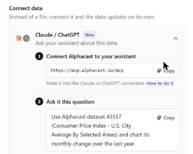

Alphacast has a hosted [Model Context Protocol (MCP)](/mcp/overview) server. Add its URL to your assistant, sign in, and ask about data. You do not need to install anything or copy an API key.

```text
https://mcp.alphacast.io/mcp
```

Free and Explorer include MCP access. Catalog access and download volume depend on your [plan](https://www.alphacast.io/pricing).

## Connect Claude

<Steps>
  <Step title="Open Connectors">
    In Claude, open **Customize > Connectors**. In some versions, it is under **Settings > Connectors**.
  </Step>
  <Step title="Add Alphacast">
    Click **+**, then **Add custom connector**. Enter the name `Alphacast` and the URL above. Click **Add**.
  </Step>
  <Step title="Sign in">
    Click **Connect**. Sign in with your Alphacast account and authorize access in your browser.
  </Step>
  <Step title="Test it">
    Open a new chat and send: "List my Alphacast repositories." Check that Claude calls an Alphacast tool.
  </Step>
</Steps>

Custom connectors depend on your Claude plan. See [Claude Desktop](/mcp/configuration/claude-desktop) for other options, or [Claude Code](/mcp/configuration/claude-code) if you work in a terminal.

## Connect ChatGPT

<Steps>
  <Step title="Add the connector">
    In ChatGPT's connector settings, add a custom connector with the URL above. Where this option is, and whether you can use it, depend on your ChatGPT plan and settings.
  </Step>
  <Step title="Sign in">
    Sign in with your Alphacast account and authorize access.
  </Step>
  <Step title="Test it">
    Start a chat with the connector enabled and ask about a dataset. Check that ChatGPT calls Alphacast.
  </Step>
</Steps>

## Ask about a specific dataset

On a dataset page, click **Download**. Under **Connect data**, open **Claude / ChatGPT**. Copy the MCP URL, then copy the suggested question. It names the dataset by its ID, like this:

```text
Use Alphacast dataset <ID> (<dataset name>) and chart its monthly change over the last year.
```

<Frame>
  
</Frame>

## Get better answers

- Name the dataset ID when you know it.
- State the countries, columns and date range you need.
- Ask the assistant to show the source dataset and the latest date it used.
- Check important figures in Alphacast.

See [prompting tips](/mcp/prompting) and [examples](/mcp/examples).

## What the assistant can access

It acts with your Alphacast account, in your active [workspace](/workspaces). Your repository permissions and plan apply. Some tools can create, change or run [pipelines](/steps/overview), so review what the assistant plans to do before you approve it. Available tools can vary by workspace. See the [tools reference](/mcp/tools/overview).

If you switch workspaces, the connection may take a short time to follow. Reconnect if it still shows the previous one.

## Fix connection problems

If the assistant answers without calling a tool, check that the connector is connected and enabled in the chat. If it disconnected, connect and sign in again. See [troubleshooting](/mcp/troubleshooting).
