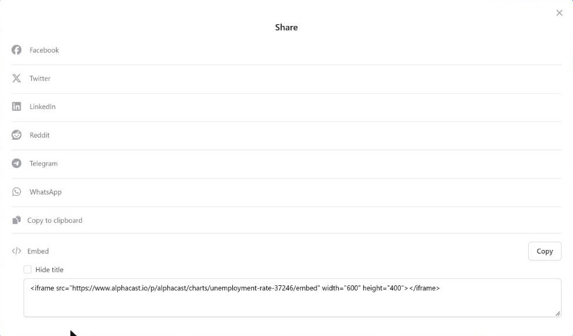

You can show a chart, dashboard or AI View on a web page with an `iframe`.

Embedding charts, dashboards, and agents is available on the **Workspace** plan. You may see the **Embed** option on other plans, but you need Workspace to use embeds on your site. See [pricing](https://www.alphacast.io/pricing).

## Get the embed code

<Steps>
  <Step title="Open the Share window">
    Open the menu on a chart card in a repository's **Views** tab, on an AI View or on a dashboard. Click **Share**.
  </Step>
  <Step title="Choose Embed">
    Click **Embed**. Check **Hide title** if you want to request the content without its title.
  </Step>
  <Step title="Copy the code">
    Click **Copy**, then paste the code into your page.
  </Step>
</Steps>

<Frame>
  
</Frame>

The code looks like this:

```html
<iframe src="https://www.alphacast.io/p/<owner>/charts/<chart>/embed" width="600" height="400"></iframe>
```

## Adjust the size

Change `width` and `height` to fit your page. For a flexible width, use a style:

```html
<iframe src="<your embed URL>" style="width: 100%; height: 600px; border: 0;"></iframe>
```

Test the result on a phone. Dashboards usually need more height than a single chart.

## Control who can see it

An embed does not grant access. [Repository permissions](/concepts/repositories#privacy) still apply. For content that every visitor should see without signing in, keep it in a public repository. This also applies to each item inside an embedded dashboard.

Test your page in a private browser window to see what a visitor sees.

## Keep embeds working

- An embed loads the content from Alphacast. You do not need to replace the code after the data updates, although a change can take a while to appear.
- If you delete the content or make it private, visitors may stop seeing it.
- Some website builders do not allow `iframe` elements. Check your site's settings.

## Next steps

<CardGroup cols={2}>
  <Card title="Charts" icon="chart-line" href="/charts">
    Create the charts to embed.
  </Card>
  <Card title="Dashboards" icon="table-cells-large" href="/dashboards">
    Build a page with several items.
  </Card>
</CardGroup>
