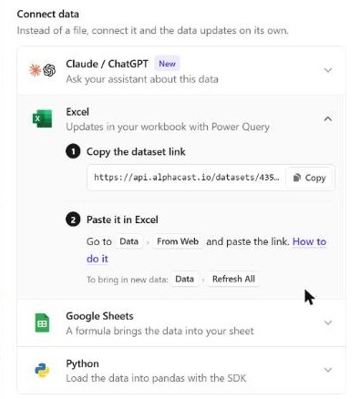

Excel can read an Alphacast dataset from a link. You load it with **From Web** (Power Query), then refresh the workbook to bring in new data. You do not need an add-in.

## Before you start

You need to be signed in. You get the full data if you have full download access to the dataset. Otherwise, the panel tells you that you are downloading a preview. See [pricing](https://www.alphacast.io/pricing).

## Load a dataset

<Steps>
  <Step title="Open the dataset">
    Apply any filters for columns, entities or dates. The link keeps them.
  </Step>
  <Step title="Copy the link">
    Click **Download**. Under **Connect data**, open **Excel** and copy the dataset link.
  </Step>
  <Step title="Paste it in Excel">
    In Excel, go to **Data > From Web**, paste the link and follow the prompts to load the table.
  </Step>
</Steps>

<Frame>
  
</Frame>

There is also a [video walkthrough](https://youtu.be/JDbCPBrvfX4). Menu names can differ between Excel versions.

## Refresh the data

Go to **Data > Refresh All**. Excel requests the link again and loads the data that Alphacast currently has, within your access and limits.

## Adjust what you load

Set these options in the panel before you copy the link:

- **Dates as columns:** puts dates across the top.
- **Include Variable IDs:** adds the variable identifiers.

If you change filters or options, copy the new link and update your query.

## If it does not work

- **You see only part of the data:** check your download access to the dataset and your usage in [Settings](/settings), under **Membership**.
- **Refresh stopped working:** if you reset your [API key](/settings#get-or-reset-your-api-key), copy a new link.
- **You reached your download limit:** check **Settings > Membership**.
- **The dataset is too large:** an Excel sheet has row and column limits. Filter the data first. The panel hides the XLSX option when the full result does not fit in a sheet.
- **Columns changed:** a query that expects certain columns can fail when the dataset structure changes.

<Warning>
  The link contains your API key. Anyone with the link, or with a workbook that stores it, may be able to use your access. Do not share either one.
</Warning>

## Connect a pipeline result

To load the output of your own pipeline, add a [Data snapshot step](/steps/data-snapshot) and copy its download link, or [publish the result as a dataset](/steps/publish).

## Send data to Alphacast

This page covers reading data in Excel. To upload a workbook, see [your datasets](/your-data/datasets).
