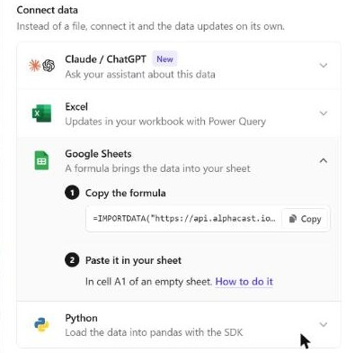

A formula brings the dataset into your sheet. You do not need an add-on.

## Before you start

You need to be signed in. You get the full data if you have full download access to the dataset. Otherwise, the panel tells you that you are downloading a preview. See [pricing](https://www.alphacast.io/pricing).

## Load a dataset

<Steps>
  <Step title="Open the dataset">
    Apply any filters for columns, entities or dates. The formula keeps them.
  </Step>
  <Step title="Copy the formula">
    Click **Download**. Under **Connect data**, open **Google Sheets** and copy the formula.
  </Step>
  <Step title="Paste it">
    Paste the formula in cell `A1` of an empty sheet. If Google asks you to allow access to external data, review the request.
  </Step>
</Steps>

The formula looks like this:

```text
=IMPORTDATA("<your dataset CSV link>")
```

<Frame>
  
</Frame>

Keep calculations and notes in a separate tab. The formula needs empty space to fill, and the size of the result changes with the data.

## How updates work

Google Sheets decides when to fetch the link again. A new value in Alphacast may not appear right away.

## Adjust what you load

**Dates as columns** and **Include Variable IDs** change the data that the formula returns. Set them before you copy it. If you change filters or options, copy the new formula.

## If it does not work

- **Error in the cell:** make sure that you copied the whole formula and that the cells below and to the right are empty.
- **Only part of the data:** check your download access and usage in [Settings](/settings), under **Membership**.
- **Stopped working after a key reset:** copy a new formula. See [your API key](/settings#get-or-reset-your-api-key).
- **Large dataset:** Google Sheets has its own size limits. Filter the data to load less.

<Warning>
  The formula contains your API key. Anyone who can see the formula can read the key. Do not share that spreadsheet, and never make it public.
</Warning>

## Use a Google Sheet as a data source

To send a sheet to Alphacast and keep it updated, see [sync a dataset from Google Drive](/your-data/sync#sync-a-dataset-from-google-drive).
