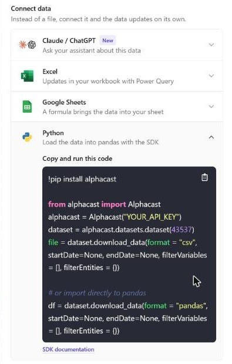

The Alphacast Python SDK loads datasets into pandas. The app can write the code for the dataset you are viewing.

## Copy code from a dataset

<Steps>
  <Step title="Open the dataset">
    Apply any filters for columns, entities or dates. The code includes them.
  </Step>
  <Step title="Copy the code">
    Click **Download**. Under **Connect data**, open **Python** and copy the code.
  </Step>
  <Step title="Run it">
    Paste it in a notebook. The first line, `!pip install alphacast`, uses notebook syntax. In a script, remove that line and run `pip install alphacast` in your terminal.
  </Step>
</Steps>

<Frame>
  
</Frame>

## Write it yourself

Keep your API key out of your code. This example reads it from an environment variable.

```bash
pip install alphacast
```

```python
import os
from alphacast import Alphacast

alphacast = Alphacast(os.environ["ALPHACAST_API_KEY"])

dataset_id = 12345  # replace with your dataset ID
df = alphacast.datasets.dataset(dataset_id).download_data(format="pandas")
print(df.head())
```

To get your key, see [account settings](/settings#get-or-reset-your-api-key).

<Warning>
  The code that you copy from the app contains your API key. Remove it before you share a notebook or commit code.
</Warning>

## Access and limits

Your [plan](https://www.alphacast.io/pricing) and repository permissions determine which data you get and how much you can download.

## Next steps

<CardGroup cols={2}>
  <Card title="Python quickstart" icon="bolt" href="/python-sdk/quickstart">
    Create, upload and download a dataset.
  </Card>
  <Card title="Download data" icon="download" href="/python-sdk/downloading">
    Filter by date, entity and column.
  </Card>
  <Card title="Search" icon="magnifying-glass" href="/python-sdk/search">
    Find datasets from code.
  </Card>
  <Card title="Upload data" icon="upload" href="/python-sdk/uploading">
    Send DataFrames to Alphacast.
  </Card>
</CardGroup>
