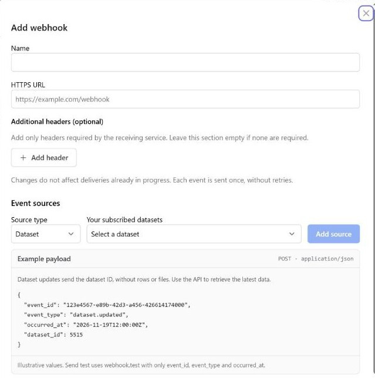

A webhook sends an HTTP `POST` with a JSON body to your URL when:

- A dataset you follow has new, revised or deleted data.
- One of your [pipeline notifications](/steps/notification) triggers.

You manage webhooks in [**Settings > Webhooks**](https://www.alphacast.io/settings?tab=Webhooks). Each one belongs to you in the current [workspace](/workspaces).

## Requirements

- A public HTTPS URL on port 443, without a username, password or `#` fragment.
- To use a dataset as a source, [follow it](/notifications#follow-a-dataset) first.
- To use a pipeline notification, you must be its subscriber and keep access to its pipeline.

## Add a webhook

<Steps>
  <Step title="Start">
    Go to **Settings > Webhooks** and click **Add webhook**.
  </Step>
  <Step title="Set the destination">
    Enter a **Name** and the **HTTPS URL**. Add **Additional headers** only if your receiving service needs them.
  </Step>
  <Step title="Add sources">
    Under **Event sources**, choose a **Source type** (**Dataset** or **Pipeline notification**), select an item and click **Add source**.
  </Step>
  <Step title="Save">
    Click **Save**.
  </Step>
  <Step title="Test it">
    Open the webhook and click **Send test**. Check the result in **Delivery history**. Save your changes before you test.
  </Step>
</Steps>

<Frame>
  
</Frame>

## Event format

Every event has `event_id`, `event_type` and `occurred_at` (UTC). `occurred_at` is when Alphacast published the update or evaluated the alert. It is not the date of an observation. The values below are examples.

<Tabs>
  <Tab title="Dataset update">
    ```json
    {
      "event_id": "123e4567-e89b-42d3-a456-426614174000",
      "event_type": "dataset.updated",
      "occurred_at": "2026-11-19T12:00:00Z",
      "dataset_id": 5515
    }
    ```

    The event has no rows or files. Use your own access to [get the latest data](/api/datasets/data). It may already include a later update.

    An upload with no data changes, or a change to metadata only, does not create an event.
  </Tab>
  <Tab title="Pipeline notification">
    ```json
    {
      "event_id": "notification_123e4567-e89b-42d3-a456-426614174000",
      "event_type": "pipeline.notification.triggered",
      "occurred_at": "2026-11-19T12:00:00Z",
      "pipeline_id": 123,
      "step_id": 456,
      "notification_id": "123e4567-e89b-42d3-a456-426614174000",
      "subject": "Prices increased",
      "body": "The latest value exceeded the configured threshold."
    }
    ```

    Previews, and runs that do not meet the condition, do not send events.
  </Tab>
  <Tab title="Test">
    A test has `event_type` set to `webhook.test` and only the three common fields.
  </Tab>
</Tabs>

## Authenticate requests

Alphacast does not add your API key to webhook requests. To let your service check who is calling, set a secret in an additional header and verify it in your receiver. Keep the URL private too.

Saved URLs and header values are not shown again. When you edit a webhook, leave a value blank to keep it. Remove a header row to delete that header.

## Delivery behavior

- Each event is sent **once**. There are no retries and no resend button.
- A `2xx` response means that your service received the event. It does not mean that your workflow finished.
- Other responses, redirects, timeouts and connection errors count as failed. Redirects are not followed.
- Respond quickly. An attempt has a time limit of 10 seconds at most. Do long work after you respond.
- Delivery is best effort. Event order is not guaranteed, and an event can be missed. If you cannot miss a change, also check the data directly.

## Check delivery history

The **Delivery history** tab lists attempts with their status (**Delivered**, **Failed** or **Sending**), time, HTTP status and duration. Expand a row to see the event ID, error and response. Large responses may not be shown. The history does not refresh on its own, so click **Refresh**.

## Edit, delete and choose channels

Changes apply to later events. To stop sending, delete the webhook from its actions menu. There is no pause option. Sends already in progress continue.

In a pipeline Notification step, **Delivery channels** lets the person who created the alert choose email, webhooks or both. To turn off email, connect a webhook first. If you later remove all its webhooks while email is off, the alert is not delivered through any channel.

## Limits

| Item | Limit |
| --- | --- |
| Webhooks per user in each workspace | 50 |
| Event sources per webhook | 200 |
| Additional headers per webhook | 20 |
| Test sends | One per webhook every 10 seconds |
