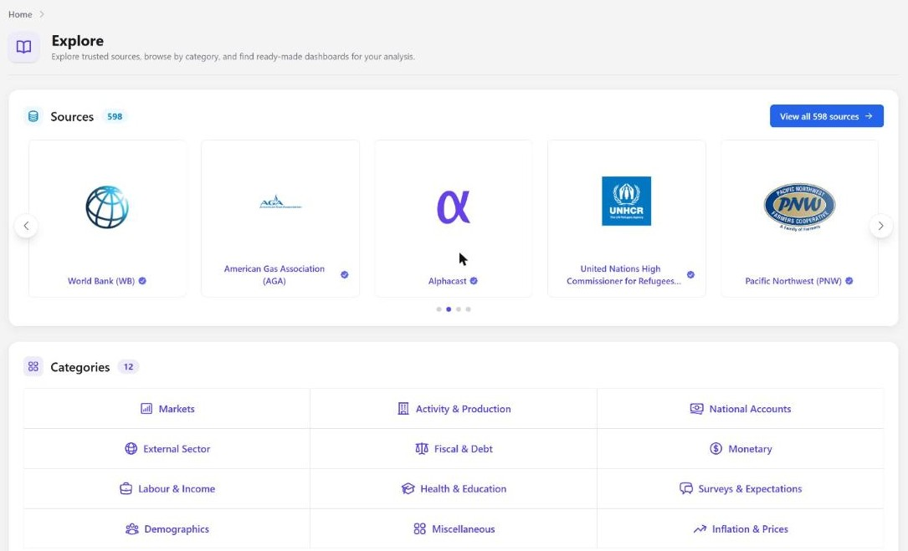

The Alphacast catalog has 9,000+ curated datasets from 600+ sources. Open **Explore** in the left menu to browse it.

A **source** is where the data comes from. Its **publications** group related data, and each publication holds [datasets](/concepts/datasets).

<Frame>
  
</Frame>

## What is on the Explore page

- **Sources**: a carousel of data sources. Use **View all** to see the full list.
- **Categories**: topics you can open to find related subcategories, sources, publications, and dashboards.
- **Dashboards**: ready-made dashboards. Cloning them depends on your plan. See [dashboards](/dashboards).

## Browse by source

<Steps>
  <Step title="Open the source list">
    In **Sources**, use **View all**.
  </Step>
  <Step title="Narrow it down">
    Filter by **Country** or **Category**. Click **Clear all** to start over.
  </Step>
  <Step title="Open a publication">
    Open a source, then choose one of its **Publications**.
  </Step>
  <Step title="Pick a dataset">
    Search or sort the publication's **Datasets**, then open one. When available, **Original source** links to where the data comes from.
  </Step>
</Steps>

## Filter publications by catalog

Catalog data is grouped into the **Starter**, **Professional**, and **Business** catalogs. A badge on a dataset shows its catalog. Click it to see publications in that catalog.

Where catalog filters appear, choose one catalog or **All catalogs**. When the option is shown, select **Downloadable with my plan** to see only publications you can download.

Finding a dataset doesn't mean you can download it. What you can view, ask the AI about, and download depends on your [plan](https://www.alphacast.io/pricing).

## Search

<Steps>
  <Step title="Open search">
    Press `Ctrl+K` (`⌘K` on Mac) or click the search box.
  </Step>
  <Step title="Type what you need">
    Include the indicator and the country or entity, such as `unemployment Chile`.
  </Step>
  <Step title="Open a result or see them all">
    Pick a result, or click **View all results**. On the results page, you can filter by result type and category, or use **Advanced Search**.
  </Step>
</Steps>

If you don't know which words to use, [ask Alphacast AI](/ai) to find the data. When signed in, you can choose **Ask Alphacast AI** from the search box after you type.

## When the catalog doesn't have it

The [API Explorer](/explore/api-explorer) lets you preview series directly from external data providers. You can also [upload your own data](/your-data/datasets) if your plan allows it.

## Next steps

<CardGroup cols={2}>
  <Card title="Dataset pages" icon="table" href="/concepts/datasets">
    Check coverage, filter, chart, and download.
  </Card>
  <Card title="API Explorer" icon="globe" href="/explore/api-explorer">
    Query external providers.
  </Card>
  <Card title="Clips" icon="paperclip" href="/clips">
    Keep useful datasets at hand.
  </Card>
  <Card title="Alphacast AI" icon="sparkles" href="/ai">
    Find and analyze data by asking.
  </Card>
</CardGroup>
