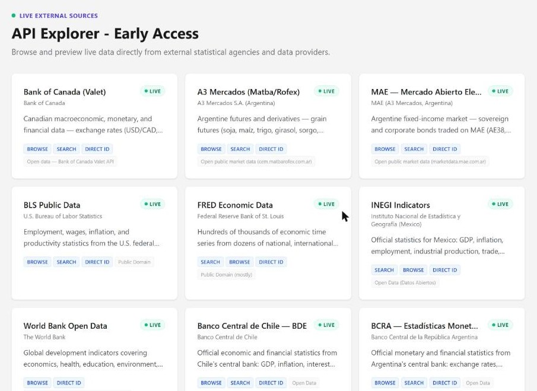

API Explorer queries external data providers, such as central banks, statistical agencies, and international organizations, from one place. It is separate from the curated [catalog](/explore): you get series directly from the provider. API Explorer is in early access.

Sign in, then open [alphacast.io/explore/apis](https://www.alphacast.io/explore/apis). That page lists the providers currently available.

<Frame>
  
</Frame>

## Find a series

<Steps>
  <Step title="Choose a provider">
    Each card has labels for how you can look for data, such as **Search**, **Browse**, or **Direct ID**.
  </Step>
  <Step title="Find the series">
    Use the options the provider supports:

    - **Search By Topic**: enter words such as `inflation` or `employment`.
    - **Browse**: open folders and categories. Some data asks you to select dimensions first, then show the matching series.
    - **Open By Series ID**: enter the provider's ID if you know it.

    Some providers also list **Popular Series**.
  </Step>
  <Step title="Open it">
    The series page shows the series information, a data table, and a chart preview on wide screens.
  </Step>
</Steps>

## Work with a series

| Action | What it does |
|---|---|
| **Filter data** | Sets dates and other options the provider offers. Click **Apply Filters**. |
| **Download** | Downloads the loaded observations as CSV. |
| **Transform Data** | Creates a [pipeline](/steps/overview) from the series. Requires a plan that can create content. |

Large series can load as a **Partial preview**. In that case, **Download preview** contains only the observations loaded. Narrow the filters for a complete result. **Transform Data** is unavailable while the preview is partial.

## Add a provider API key

Some providers require your own key. For others, a key is optional and can raise rate limits. The provider page shows the key status.

<Steps>
  <Step title="Open the key form">
    On the provider page, click **Configure API key for higher limits**, or **Manage** if you already added one. You can also open **Settings** and then **API Providers**.
  </Step>
  <Step title="Get a key">
    When a link to get a key is shown, use it to request one from the provider.
  </Step>
  <Step title="Save it">
    Paste the key and click **Save Key** (**Save** in **Settings**).
  </Step>
</Steps>

This is the provider's key, not your Alphacast [API key](/authentication).

## Limits

Availability, history, speed, and rate limits depend on each provider. A provider can be temporarily unavailable. Check each provider's license before you reuse its data.

## Other ways to use providers

- Ask [Alphacast AI](/ai) with the **All Alphacast** scope. It can find and fetch data from external providers.
- Add the [Fetch API Provider](/steps/fetch-api-provider) step to a pipeline.
- Use the [providers API](/providers/overview).

## Next steps

<CardGroup cols={2}>
  <Card title="Build a pipeline" icon="diagram-project" href="/steps/overview">
    Reshape a series and publish it as a dataset.
  </Card>
  <Card title="Explore the catalog" icon="book-open" href="/explore">
    Check for a curated dataset first.
  </Card>
</CardGroup>
