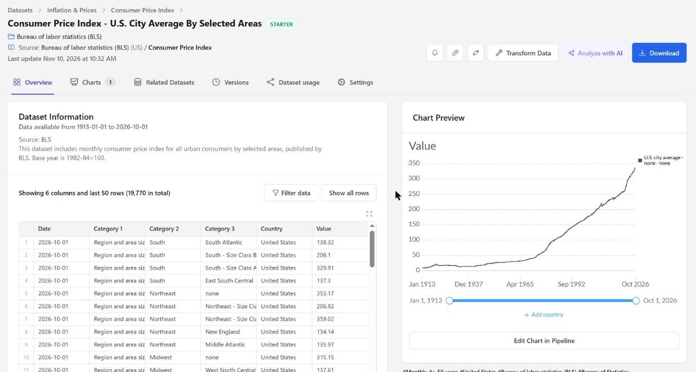

This guide takes you through the main path in Alphacast: find data, ask, save the result and keep it current, and use it in your own tools. You need an Alphacast account.

<Note>
  What you can see and download depends on your plan. On Free and Explorer you can't create most content, such as saved charts, pipelines, datasets, or dashboards. Saving requires Professional or higher. See [pricing](https://www.alphacast.io/pricing).
</Note>

## Find a dataset

<Steps>
  <Step title="Search">
    Press `Ctrl+K` (`⌘K` on Mac) or click the search box at the top. Type a topic and a country, such as `inflation Mexico`. You can also open **Explore** in the left menu and browse by source or category.
  </Step>
  <Step title="Open the dataset">
    Pick a result under **Datasets**. The dataset page shows information about the data, a data table, and a chart preview when one is available.
  </Step>
  <Step title="Check that it fits">
    Look at the dates under **Dataset Information** and the **Last update** line. Use **Filter data** to keep only the dates, entities, and variables you need.
  </Step>
</Steps>

<Frame>
  
</Frame>

## Ask Alphacast AI

<Steps>
  <Step title="Open the assistant on the dataset">
    Click **Analyze with AI** (**Ask AI** on small screens). The chat is focused on this dataset.
  </Step>
  <Step title="Ask a question">
    Type your question, for example `Chart the year-over-year change over the last five years`. You can also pick **Understand**, **Transform**, **Visualize**, or **Compare** to start from a suggested prompt, then edit it before you send it.
  </Step>
  <Step title="Check the answer">
    Open **Show analysis** to see the steps the assistant took. Check the dates, units, and series it used, and ask follow-up questions to correct anything.
  </Step>
</Steps>

To search beyond one dataset, click **Alphacast AI** in the left menu. See [Alphacast AI](/ai).

## Save the result

When the answer includes a chart, a table, or data, buttons for saving it can appear with the result.

<Steps>
  <Step title="Choose what to save">
    Click **Save chart**, **Save table**, or **Save as dataset**. For an [AI View](/ai/views), click **Save view**.
  </Step>
  <Step title="Choose a repository">
    Pick where to create it. A [repository](/concepts/repositories) is the folder that holds your work and controls who can access it.
  </Step>
  <Step title="Review it">
    Alphacast creates a [pipeline](/steps/overview). It keeps the steps the AI followed and runs them again with new data. Use **See the steps** or **Open pipeline** to review it.
  </Step>
</Steps>

On Free and Explorer, saving takes you to the pricing page. You can still [clip](/clips) datasets that you have full access to. You also can't save results built on data that you can view but not download.

## Subscribe to new data

On the dataset page, click **Subscribe** to get notified when a new version is available. The button appears when you have full access to the dataset's data and the dataset isn't deprecated. After you download a file, you can also click **Follow this dataset** in the same panel. See [notifications](/notifications).

## Use this data

On the dataset page, click **Download**. The **Use this data** panel opens. If you only have access to a sample of the dataset, you get a preview download instead.

- **Download** a file as XLSX, CSV, JSON, or TSV. XLSX isn't offered when the data is too large for a spreadsheet.
- Under **Connect data**, follow the steps for **Claude / ChatGPT**, **Excel**, **Google Sheets**, or **Python**. A connection can bring in new data without a manual download.

The filters you set on the dataset page also apply to the files and data links.

<Warning>
  Links and code copied from this panel can contain your API key. Don't share them or files that include them.
</Warning>

## Next steps

<CardGroup cols={2}>
  <Card title="Find your way around" icon="compass" href="/getting-started/navigation">
    Menus, workspaces, repositories, and the header buttons.
  </Card>
  <Card title="Connect your tools" icon="plug" href="/connect">
    AI assistants, spreadsheets, Python, and more.
  </Card>
  <Card title="Dataset pages" icon="table" href="/concepts/datasets">
    Filters, charts, versions, and downloads.
  </Card>
  <Card title="Build a pipeline" icon="diagram-project" href="/pipelines/build-with-ai">
    Transform data once and keep the result current.
  </Card>
</CardGroup>
