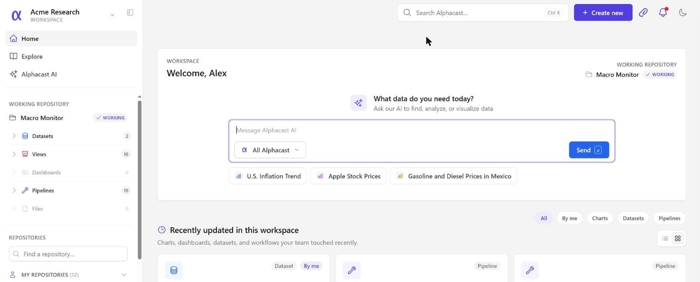

The app has a left menu for moving around and a header for searching, creating, and keeping things at hand. This page describes what you see when you are signed in on a desktop screen. On small screens, the layout is different. Some workspaces show a different set of options.

When you first reach **Home**, a short welcome tour can walk you through these areas.

<Frame>
  
</Frame>

## Switch workspaces

The name at the top of the left menu is your current workspace: your **Personal Account** or a team's **Workspace**. Each one has its own repositories and data. Click it to switch, or click **Create Team**. See [workspaces](/workspaces).

## Main menu

| Link | What it opens |
|---|---|
| **Home** | A box to ask the AI, recently updated work, and featured dashboards. |
| **Explore** | Sources, categories, and ready-made dashboards. See [Explore](/explore). |
| **Alphacast AI** | The chat assistant and your conversations. See [Alphacast AI](/ai). A workspace can show its own default agent here instead. |

In the recent work list on **Home**, you can filter by type or by **By me**, and switch between **Items** and **Cards**.

## Repositories

The left menu also shows your [repositories](/concepts/repositories). Use **Find a repository...** to search them.

Your **Working repository** is where new content goes by default. The menu groups its contents, such as datasets, views, dashboards, pipelines, and files. To change it, click **Use** next to another repository you can write to. **Recent Work** lists items you can reopen quickly.

When you save a result from the AI or transform a dataset, Alphacast can ask where to create it. Choosing a repository there doesn't change your working repository.

## Search

Click the search box or press `Ctrl+K` (`⌘K` on Mac). Switch between the **All**, **Finance**, **Data**, and **Dashboards** tabs. After you type, you can:

- Open a result directly.
- Click **View all results** for the full results page.
- Click **All Alphacast** to include all the repositories you have permission to see.
- Click **Ask Alphacast AI** to search with the assistant.

Some of these options depend on the tab you are in.

## Create new

Click **Create new** to add content, such as a **Dataset**, **File**, **Chart**, **Dashboard**, **Pipeline**, or **Repository**. The menu shows your working repository, and **Change** lets you pick another. If you don't have one selected, it asks you to choose one first.

On Free and Explorer, you can't create content from this menu. The **Repository** option stays available. See [pricing](https://www.alphacast.io/pricing).

## Clips

The paperclip icon opens **Clips**, where you keep datasets and views at hand and drag them into your work. See [Clips](/clips).

## Notifications

The bell icon opens your **Notifications**. The gear icon in that list opens **Notification settings**. See [notifications](/notifications).

## Account menu

Open your account menu at the bottom of the left menu to reach:

- **Learn**: these docs.
- **Settings**: your preferences, with tabs such as **General**, **Notifications**, **Webhooks**, **API Providers**, and **Membership**. In a team workspace, you see **Personal settings**, and **Workspace settings** if you can manage the team.
- **Upgrade**, on the free plan.
- **Sign out**.

See [settings](/settings).

## Next steps

<CardGroup cols={2}>
  <Card title="Your first 10 minutes" icon="play" href="/getting-started">
    Go from a search to data in your own tools.
  </Card>
  <Card title="Explore the catalog" icon="book-open" href="/explore">
    Browse 9,000+ curated datasets from 600+ sources.
  </Card>
</CardGroup>
