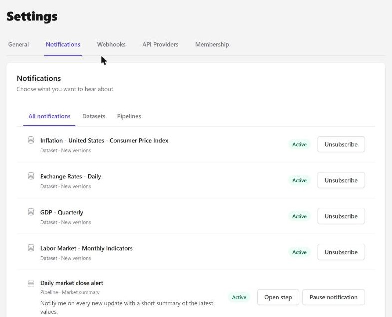

Alphacast has two kinds of notifications:

| Kind | When it arrives |
| --- | --- |
| **Dataset** | A dataset you follow has a new version |
| **Pipeline** | A [Notification step](/steps/notification) finds that your condition is met |

## Follow a dataset

Open the dataset and choose **Subscribe** in its actions. After a download, you can also click **Follow this dataset**. To stop, click **Unsubscribe**.

The **Subscribe** action on the dataset page appears when you have full download access to that dataset and it is not deprecated. See [pricing](https://www.alphacast.io/pricing).

## Create a pipeline alert

Add a [Notification step](/steps/notification) to a pipeline and describe the condition in plain language. The alert is evaluated when the pipeline runs. The person who first saves the step is the subscriber, and email goes to that person's address.

To check data regularly, the pipeline must run. See [pipeline alerts](/pipelines/alerts).

## Check the bell

Click the bell icon to see recent dataset updates and pipeline alerts. Click an item to open it. Click the gear to open the notification settings.

## Manage your notifications

Go to [**Settings > Notifications**](https://www.alphacast.io/settings?tab=Notifications).

<Frame>
  
</Frame>

Filter the list with **All notifications**, **Datasets** or **Pipelines**.

- **Datasets:** click **Unsubscribe**.
- **Pipelines:** click **Pause notification** or **Resume notification**. Click **Open step** to change the condition. A notification can be **Active**, **Paused** or **Cancelled**.

Dataset follows are personal. Pipeline notifications belong to the current [workspace](/workspaces), so switch workspaces to see others.

To resume an alert or open its step, you need editing access to the pipeline.

## Send events to another system

You can send dataset updates and pipeline notifications to a URL. See [Webhooks](/connect/webhooks).

## Next steps

<CardGroup cols={2}>
  <Card title="Pipeline alerts" icon="bell" href="/pipelines/alerts">
    Build alerts from your own conditions.
  </Card>
  <Card title="Webhooks" icon="bolt" href="/connect/webhooks">
    Trigger your own workflows.
  </Card>
</CardGroup>
