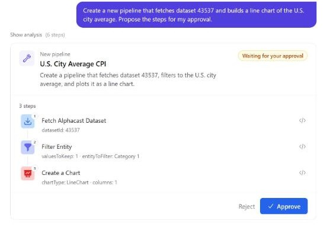

Alphacast AI can create pipelines, add, edit and delete steps, and help you fix errors. You review each change before it happens.

## Before you start

- To create or change pipelines you need a [plan](https://www.alphacast.io/pricing) that can create content, and edit access to the repository.
- Pipeline tools are part of [Alphacast AI](/ai). Custom [agents](/ai/agents) don't have them.

## Create a pipeline from a chat

<Steps>
  <Step title="Describe the result">
    In [Alphacast AI](/ai), say what data you need, how to transform it and what you want at the end. For example: "Create a pipeline with monthly US CPI from FRED, calculate the year-over-year change, and chart it."
  </Step>
  <Step title="Review the approval card">
    The card shows why the change is proposed and the steps involved. You can open the configuration of each proposed step. Its status is **Waiting for your approval**.
  </Step>
  <Step title="Approve or reject">
    Click **Approve** to make the change, or **Reject** to cancel it. Nothing changes until you approve.
  </Step>
  <Step title="Check the pipeline">
    Click **Open pipeline**. Creating a pipeline with steps starts a [run](/pipelines/runs).
  </Step>
</Steps>

New pipelines go to your working repository unless you ask for another one.

<Warning>
  A run can execute output steps. If your pipeline publishes a dataset or [sends a notification](/steps/notification), check those steps before you approve.
</Warning>

<Frame>
  
</Frame>

## Save a chat result as a pipeline

If a chat already produced the chart, table or data you want, save it. Alphacast creates a pipeline that repeats the steps behind the result.

| Result | Action |
|---|---|
| Chart | **Save chart** |
| Table | **Save table** |
| Data | **Save as dataset** |

The menu next to the button can also offer **Publish the data as a dataset** and **Download data (CSV)**. A published dataset appears when the first run finishes. Some results can't be saved, for example view-only data.

## Change a pipeline in the editor

<Steps>
  <Step title="Open the assistant">
    In the pipeline editor, click **Build with AI**. If it is unavailable, save your pending changes first.
  </Step>
  <Step title="Ask">
    For example: "Keep only data since 2015" or "Explain what step 3 does."
  </Step>
  <Step title="Approve the change">
    Review the approval card and click **Approve**. The editor reloads the pipeline.
  </Step>
</Steps>

This chat is tied to the open pipeline. It can read other pipelines as references, but it can only change this one. To create another pipeline, start a new chat.

## Fix a step error

When a step has an error, click **Fix with AI**. The assistant opens with the error. Review the proposed edit before you approve it, then check the new run.

## Write better requests

- Name the source, country, variable and frequency.
- Give the exact dataset or series ID if you know it.
- Say what the output should be: a dataset, a chart, a table or an alert.
- Ask for one change at a time when you edit a pipeline.

## Limits

- AI can choose the wrong series or transformation. Check the data with **Preview data** before you use it.
- You can't set a run schedule or choose notification recipients through the chat.
- To build pipelines from another AI assistant, use the [MCP pipeline tools](/mcp/tools/pipelines).

## Next steps

<CardGroup cols={2}>
  <Card title="Run a pipeline" icon="play" href="/pipelines/runs">
    Check results, fix failures and undo changes.
  </Card>
  <Card title="Pipeline steps" icon="diagram-project" href="/steps/overview">
    See everything a pipeline can do.
  </Card>
</CardGroup>
