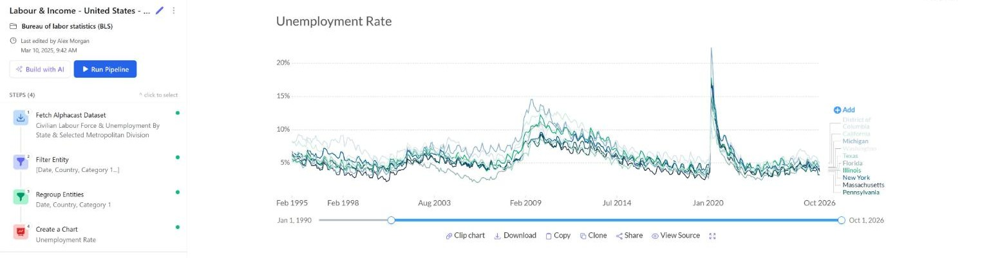

A run executes the steps of a pipeline in order. Use runs to bring in new data and to check that your pipeline works.

## When a pipeline runs

| Trigger | What happens |
|---|---|
| You add, edit or delete a step | Alphacast saves the change and starts a run. If you edit or delete a step while a run is processing, that run is cancelled. |
| You create a pipeline that already has steps | A run starts. |
| You click **Run Pipeline** | A run of the pipeline starts. |
| An Alphacast dataset that the pipeline uses gets new data | The pipeline is queued to run again. |
| You sync a dataset that the pipeline produces | The pipeline or its sources are refreshed. See [sync](/your-data/sync). |
| You download an older [Data Snapshot](/steps/data-snapshot) | If the pipeline uses Yahoo Finance or FRED fetch steps and the last run is more than 20 minutes old, a new run can start. Your download may not include it yet. |

Pipelines that import external data, such as FRED, Yahoo Finance, or API Explorer data, also run automatically once a day.

<Warning>
  Runs can execute output steps. A [publish step](/steps/publish) writes to its dataset, and a [notification step](/steps/notification) can send a notification during a normal run.
</Warning>

## Run a pipeline

<Steps>
  <Step title="Open the editor">
    Open your pipeline. Save any pending step changes.
  </Step>
  <Step title="Start the run">
    Click **Run Pipeline**. The button shows **Awaiting...** while the run is queued and **Running...** while it executes.
  </Step>
  <Step title="Check the result">
    Read **Pipeline Summary**. Click **Show full logs** to see more detail.
  </Step>
</Steps>

<Frame>
  
</Frame>

## Preview step output

Select a step and open **Preview data**. Click **Generate preview** or **Refresh preview**. For large outputs, the table shows the latest rows. Click **Download CSV** to get the preview data.

The preview reflects the saved step. Save your changes before you refresh it. A preview runs the steps it needs to build the data, so it can take a while. Starting one cancels a run of the pipeline that is processing.

## Run statuses

| Editor | API status | Meaning |
|---|---|---|
| **Pipeline awaiting** | `new` | Queued. |
| **Pipeline running** | `processing` | Executing. |
| **Pipeline processed** | `completed` | The run finished. |
| **Pipeline error** | `failed` | A step failed. |
| **Pipeline cancelled** | `cancelled` | The run was stopped, for example by a newer change. |
| | `skipped` | The run was not executed, for example because a newer run replaced it or there was nothing to run. |

## Fix a failed run

When a step fails, the steps after it don't run.

<Steps>
  <Step title="Find the error">
    In **Pipeline Summary**, click **Review step error**. The editor opens the failed step on its **Error** tab.
  </Step>
  <Step title="Fix the cause">
    Edit the step, or an earlier step that changed its input, and press **Save**. You can also click **Fix with AI**. See [Build with AI](/pipelines/build-with-ai#fix-a-step-error).
  </Step>
  <Step title="Retry">
    If the failure was temporary, such as an unavailable source, click **Retry from step** to start a new run.
  </Step>
</Steps>

Common causes are a column that was renamed or removed upstream, a source that returned no data, and missing access to a source dataset.

## Undo the last change

Open the pipeline options menu and click **Undo last change**. Alphacast restores the previous version of the pipeline and runs it. Undo doesn't recall messages that were already sent.

## Follow a run from an AI assistant

From an AI assistant connected through MCP, use [`wait_pipeline_run`](/mcp/tools/pipelines#wait_pipeline_run).

## Next steps

<CardGroup cols={2}>
  <Card title="Alerts" icon="bell" href="/pipelines/alerts">
    Get notified when a run finds what you are looking for.
  </Card>
  <Card title="Publish to Dataset" icon="upload" href="/steps/publish">
    Save the output as a dataset that updates with the pipeline.
  </Card>
</CardGroup>
