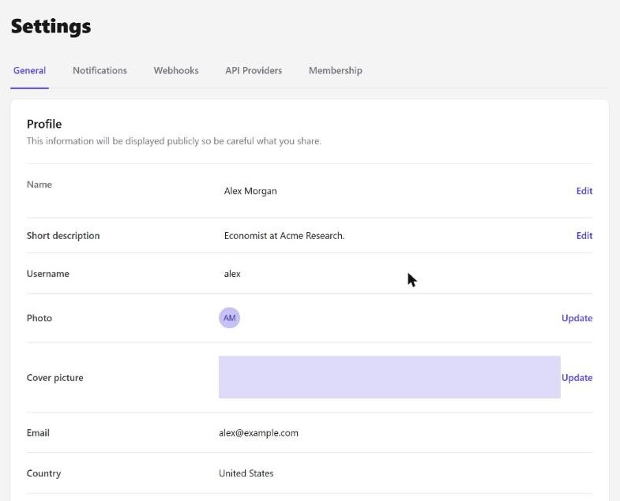

Open [**Settings**](https://www.alphacast.io/settings) from the user menu. In a team workspace, your own settings are under **Personal settings**. Team settings are under [**Workspace settings**](/workspaces#manage-team-members).

<Frame>
  
</Frame>

| Tab | What you manage |
| --- | --- |
| **General** | Profile, password, API key and language |
| **Notifications** | [Dataset follows and pipeline alerts](/notifications) |
| **Webhooks** | [Event delivery to a URL](/connect/webhooks) |
| **API Providers** | Your keys for external data providers. Not shown in all workspaces |
| **Membership** | [Plan](https://www.alphacast.io/pricing), usage and billing. Not shown in all workspaces |

## Edit your profile

In **General**, you can update your name, short description, photo and cover picture. Alphacast notes that profile information is displayed publicly, so be careful what you share. You can also add details such as your country, job title and company. Use **Reset Password** to change your password.

## Change the language

Under **Language**, choose **English** or **Español**, then click **Update**.

## Get or reset your API key

You use your API key with the [REST API](/authentication), the [Python SDK](/python-sdk/authentication) and the local [MCP server](/mcp/authentication).

<Steps>
  <Step title="Show the key">
    In **General**, find **API Key** and click **Show Key**.
  </Step>
  <Step title="Reset it if needed">
    Click **Reset** and confirm. Then update every place that used the old key.
  </Step>
</Steps>

<Warning>
  Treat your API key like a password. Download links for [Excel](/connect/excel) and [Google Sheets](/connect/google-sheets) contain it. Resetting the key can stop your scripts and spreadsheet connections from working.
</Warning>

## Add keys for data providers

Some external providers in the [API Explorer](/explore/api-explorer) require or accept your own key. In **API Providers**:

1. Find the provider. **Get key** opens the provider's site, when a link is available.
2. Paste the key and click **Save**.

Each provider shows **Configured** or **Not configured**. Use **Remove key** to delete a saved key. These keys are not your Alphacast API key.

## Membership and billing

**Membership** shows your current plan and usage. For your personal account, it can also show the next invoice, payment method and recent invoices. With a paid plan, click **Manage billing** to make changes.

## Next steps

<CardGroup cols={2}>
  <Card title="Pricing" icon="credit-card" href="https://www.alphacast.io/pricing">
    Compare plan features.
  </Card>
  <Card title="Connect" icon="plug" href="/connect">
    Use your data in other tools.
  </Card>
</CardGroup>
