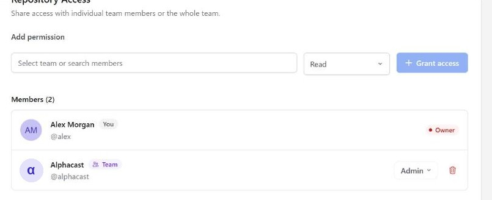

Access in Alphacast is mainly set per [repository](/concepts/repositories). To share private work, add people to the repository that holds it. Sharing options depend on your [plan](https://www.alphacast.io/pricing).

<Frame>
  
</Frame>

## Add people to a repository

You need **Admin** access.

<Steps>
  <Step title="Open Repository Access">
    Open the repository, go to **Settings** and find **Repository Access**.
  </Step>
  <Step title="Find the account">
    Under **Add permission**, search by email address or username. In a team repository, you can select the team or search its members.
  </Step>
  <Step title="Choose a permission">
    Select **Read**, **Clone**, **Write** or **Admin**. Some accounts can only receive some of these levels. Check **Notify by email** if you want Alphacast to send an email.
  </Step>
  <Step title="Grant access">
    Click **Grant access**.
  </Step>
</Steps>

See [permission levels](/concepts/repositories#permission-levels) for what each one allows.

## Invite someone who has no account

These options are available in personal repositories.

- **By email:** search for the email address. If no account uses it, send an invitation with the permission you selected. The person must accept it with an account for the invited email address.
- **By link:** under **Generate an invitation link**, click **Generate**, then **Copy**. The link grants **Read** permission to anyone who uses it. It is valid for 7 days.

You can review open invitations under **Pending invitations** and revoke them. A revoked link stops working immediately.

For team repositories, first add the person to the [team workspace](/workspaces#manage-team-members).

## Change or remove access

In the **Members** list, change a person's permission or click the remove icon, then confirm. Changes apply right away. A removed member loses the access that this membership gave.

## Find content shared with you

Repositories shared with you appear under **Shared with me**. Repositories shared with your team appear under **Shared with my team**.

A team repository can also be shared with other teams of the same organization, if your organization is set up that way. Those teams can get **Read** or **Clone** access.

## Share a link to a chart or dashboard

Open the menu on a chart, AI View or dashboard and click **Share**. You can post the link to a social network or choose **Copy to clipboard**.

A link does not grant access. Content in a private repository stays visible only to people with access to it. To show content on a website, see [Embeds](/connect/embeds).

## Public dashboards with private content

A public dashboard can include content from private repositories, but readers without access will not see it. Alphacast marks those items in the editor and asks you to confirm before saving. To fix this, make their repositories public or remove the items.

## Next steps

<CardGroup cols={2}>
  <Card title="Build a dashboard" icon="table-cells-large" href="/dashboards">
    Put charts and text on one page.
  </Card>
  <Card title="Team workspaces" icon="users" href="/workspaces">
    Manage the people in your team.
  </Card>
</CardGroup>
