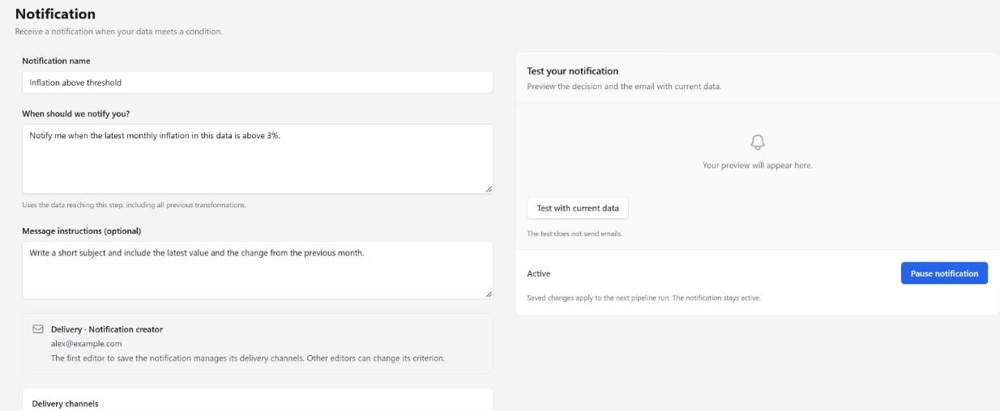

The **Send a notification** step checks the data that reaches it against your condition each time it is evaluated in a pipeline run. You write the condition in plain language, and AI evaluates it and writes the message. When the condition is met, you receive a notification.

The step does not change your data. It passes its input to the next step.

<Frame>
  
</Frame>

<Steps>
  <Step title="Add the step">
    Place it after the steps that prepare the data you want to watch. In the step list, choose **Send a notification** under **Alphacast AI**.
  </Step>
  <Step title="Describe the notification">
    Fill in **Notification name** and **When should we notify you?** Optionally, add **Message instructions (optional)**.
  </Step>
  <Step title="Save">
    Press **Save**. Saving a new, valid notification subscribes you.
  </Step>
  <Step title="Test it">
    Click **Test with current data**. The test doesn't send anything.
  </Step>
</Steps>

<Warning>
  Saving enables the notification. The first normal pipeline run can send it, even if you haven't tested it. This includes a run that starts when a pipeline is created with the step.
</Warning>

## Configuration

| Field | Description | Limit |
|---|---|---|
| **Notification name** | Your label for the notification. It is not the email subject. Required. | 200 characters |
| **When should we notify you?** | The condition to evaluate. Required. | 6,000 characters |
| **Message instructions (optional)** | What the subject and body should include. To use an exact subject, write it here and ask for it to be used verbatim. | 3,000 characters |

Example condition: "Notify me when the latest monthly inflation exceeds 3%."

## What gets evaluated

- Only the data that reaches the step, including all earlier transformations. It doesn't compare with a snapshot from a previous run.
- If your condition is about a change over time, keep the earlier dates in the data.
- The input must be small enough to evaluate. The limit is 100,000 characters, including the condition and data descriptions. If the data is too large, select columns or filter dates first.

You can add several notification steps anywhere in a pipeline. Each one evaluates its own input.

## Test the notification

**Test with current data** needs a saved step with at least one step before it. It prepares the input from the previous step and shows one of these results, with a reason:

- **A notification would be sent**, with the subject and body.
- **No notification would be sent**.
- **More information is needed**, with what is missing.

## Who receives it

The first editor who saves a valid notification becomes its only recipient. Email goes to that user's registered address. Other editors can change the condition, but they can't change the recipient, delivery channels or paused state. You can't add other recipients.

To receive it, you must keep edit access to the pipeline, access to its source data, membership in the Workspace where you subscribed, and a plan that allows data downloads.

For delivery channels, pausing and troubleshooting, see [Get pipeline alerts](/pipelines/alerts).

## Next steps

<CardGroup cols={2}>
  <Card title="Get pipeline alerts" icon="bell" href="/pipelines/alerts">
    Set up an alert from start to finish and manage it.
  </Card>
  <Card title="Filter Dates" icon="calendar" href="/steps/filter-dates">
    Keep only the period your condition needs.
  </Card>
</CardGroup>
