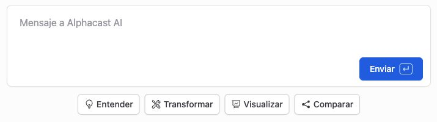
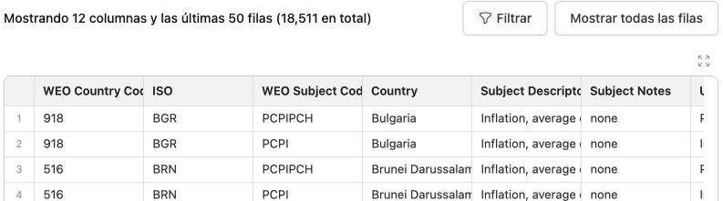

Open the [IMF's annual inflation dataset](https://www.alphacast.io/datasets/inflation-average-consumer-prices-latest-report-yearly-38797) and choose **Analyze with AI**. Starting here gives the conversation the dataset you are looking at.

## Ask about the measure

Choose **Understand** and edit the suggested question before sending it. Try this:

> What does PCPIPCH measure in this dataset? Explain its unit and frequency, and how it differs from PCPI. Which columns did you use?

<Frame caption="The dataset assistant offers four starting points. In this Spanish-language session, Entender is Understand and Visualizar is Visualize.">
  
</Frame>

## Compare like with like

In the same conversation, ask:

> Using only this dataset, show annual average consumer price inflation for Argentina and Brazil for 2020–2023. Use PCPIPCH, report percent change, and return a table with one row per year and a column per country. Mark missing values.

Four years and two countries give you eight country-year observations to check. Ask the assistant to identify any missing observations before interpreting a trend.

## Check one number yourself

Return to the source table. Use **Filter** to narrow the data, or [download the file](/workspace/find-and-download-data). Locate Brazil, 2023, and subject code `PCPIPCH`. Compare the value and unit with the assistant's table. If the numbers differ, ask it to show the source row and its rounding.

<Frame caption="The same country can have both PCPIPCH and PCPI rows. Use the subject code to match the observation.">
  
</Frame>

For a visual follow-up, ask for a line chart over the same years with one line per country and a percent label on the vertical axis. To keep an editable chart in your team's repository, follow [Create and share a chart](/workspace/share-a-chart).
