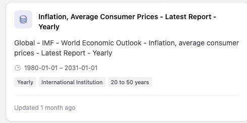
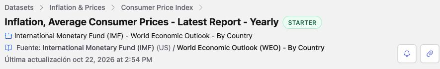

Suppose you want to compare inflation in Brazil and Argentina. Start with the IMF's annual change in average consumer prices. The World Economic Outlook also includes a price index and an end-of-period measure, so the dataset title and units both matter.

## Find the IMF series

1. Open [Explore](https://www.alphacast.io/explore) and choose **Sources**. Find **International Monetary Fund (IMF)**.
2. Open the [World Economic Outlook (WEO) - By Country publication](https://www.alphacast.io/sources/international-monetary-fund-imf-51/pubs/world-economic-outlook-weo-by-country-902). The similarly named **By Country Groups** publication contains aggregates.
3. Search the publication for `Inflation` and open [Inflation, Average Consumer Prices - Latest Report - Yearly](https://www.alphacast.io/datasets/inflation-average-consumer-prices-latest-report-yearly-38797).

<Frame caption="The dataset card shows the measure, frequency and date range.">
  
</Frame>

## Check what the numbers measure

The header identifies the source, publication and last update. In the data table, look at **Country**, **WEO Subject Code** and **Units**. For annual inflation, use `PCPIPCH` (**Percent change**). The `PCPI` rows contain an **Index**. Check the period as well, since WEO releases include projections.

<Frame caption="The IMF publication and the update date appear directly under the dataset title.">
  
</Frame>

## Download a copy

Sign in with an account that has access to the dataset. Choose **Download**, then the download button beside **XLSX** for Excel or **CSV** for a delimited file. Open the file and find the rows for the two countries and the subject code above. The table in Workspace shows a sample, so check its row count before using it to assess coverage.

To return to this dataset later, choose **Clip Dataset** (paperclip). To receive notifications when a new version is available, choose **Subscribe** (bell).

[Analyze the same dataset with Alphacast AI](/workspace/analyze-with-ai).
