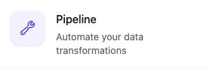

A pipeline saves the choices you would otherwise repeat on each download. In this example, the output is a dataset of annual inflation for Argentina and Brazil in 2020–2023. Start in a workspace where you can create pipelines and write to the destination repository.

## Start with the IMF dataset

Open **Create new**, check the working repository, and choose **Pipeline**. Name it **Argentina and Brazil annual inflation**. In the editor, select **Fetch Alphacast Dataset** as the first step. Search for **Inflation, Average Consumer Prices - Latest Report - Yearly** from the IMF's WEO by-country publication, select it, and save.

<Frame caption="Pipeline in the Create new menu opens the editor.">
  
</Frame>

<Frame caption="Use Fetch Alphacast Dataset for a series already in the Alphacast catalog.">
  
</Frame>

## Narrow the rows and preview each change

| Step to add | Configure it | What to look for in the preview |
| --- | --- | --- |
| [Filter Entity](/steps/filter-entity) | Choose the country entity and **Keep** Argentina and Brazil. If the dataset exposes **ISO** as the entity, use **ARG** and **BRA**. | Only the two selected countries remain. |
| [Filter Rows](/steps/filter-rows) | Use the formula editor to select **WEO Subject Code** and keep rows equal to the text `PCPIPCH`. | **Units** reads **Percent change**. The index rows (`PCPI`) have dropped out. |
| [Filter Dates](/steps/filter-dates) | Set a fixed interval from January 1, 2020 through December 31, 2023. | The dates fall within the four example years. |

Use **Add step** after the preceding step. Save the configuration and open **Preview data** before continuing. If the entity selector is empty, run the preview for its input. If a filter returns no rows, compare the exact code or spelling with the previous step's preview.

## Publish and check the output

Add [Publish to Dataset](/steps/publish), give the output a distinct name such as **Average annual inflation — Argentina and Brazil, 2020–2023**, and select the destination repository. Save the step, then choose **Run Pipeline**. When the run finishes, open the dataset link in the publish step.

Compare the result with the original WEO table. Each country should have at most one observation per year for this measure. If an expected year is missing, check the source and each saved filter. Future successful runs write the result to the same output dataset. The fixed date interval keeps the comparison at 2020–2023 until you change it.

You can now [chart the output](/workspace/share-a-chart). To extend the workflow, use [Merge with Dataset](/steps/merge) to join another indicator on country and date, or [Data Snapshot](/steps/data-snapshot) to produce a downloadable file.
