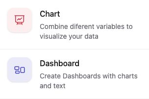

You need a workspace where your plan allows chart creation and a repository you can write to. To practice adding a chart to a dashboard you already edit, you can start at the last section with an [existing Alphacast chart](https://www.alphacast.io/p/alphacast/charts/inflation-forecast-23643).

## Choose where your work will live

Use the workspace switcher to select your personal account or team. Open **Create new** and check **Working repository** at the top of the menu. Choose **Change** if you want to save the chart somewhere else. Then select **Chart**.

<Frame caption="Choose Chart to build a visualization. Dashboard groups charts and text on a page.">
  
</Frame>

## Build the comparison

1. In the chart step, open the variable picker and search for the [IMF average consumer prices dataset](https://www.alphacast.io/datasets/inflation-average-consumer-prices-latest-report-yearly-38797). For a simpler picker, use the [filtered dataset from the pipeline walkthrough](/workspace/first-pipeline).
2. Choose the percent-change series for Argentina and Brazil. Select a line chart, keep a common time range, and check that the legend distinguishes the two countries.
3. Give the chart a title such as **Annual average inflation in Argentina and Brazil**, label the unit **Percent change**, and identify the IMF World Economic Outlook as the source. Save the chart configuration. See the [chart step reference](/steps/chart-data) for the editor tabs.

## Put the chart on a dashboard

Open the saved chart and use the paperclip to clip it. In the **Chart clipped** notification, choose **Add to a dashboard**, select a dashboard you can edit, and choose its section. If you need a new dashboard, create it first from **Create new** → **Dashboard**.

Open the dashboard and check that the chart appears in the intended section. Share the dashboard's page URL with a teammate who can read it. The chart's own access still matters: a public dashboard can contain a private chart that some viewers cannot open. Check the result with the same access level as your audience. See [repository permissions](/concepts/repositories).
