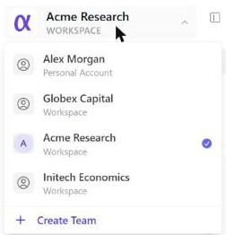

A workspace is your personal account or a team you belong to. It determines which repositories you see and where new work is saved.

## Switch workspaces

Open the workspace menu, which shows the current workspace name, and select another one. Your own account is labeled **Personal Account**. Teams are labeled **Workspace**.

<Frame>
  
</Frame>

Check the active workspace before you:

- Create content or choose a [working repository](/concepts/repositories#choose-your-working-repository).
- Manage [pipeline notifications](/notifications) or [webhooks](/connect/webhooks).
- Use a [connected AI assistant](/connect/assistants), which works with your active workspace.

## Find repositories

Your workspace lists its own repositories. Repositories from other accounts appear in separate sections:

- **Shared with me:** shared directly with you.
- **Shared with my team:** shared with the team workspace you are in.

Access to a repository owned by another team does not add that team to your workspace menu.

## Team workspaces

A team workspace lets people work in shared repositories. Collaboration features and seats depend on your [plan](https://www.alphacast.io/pricing). Our team sets up team workspaces. To request one, write to [hello@alphacast.io](mailto:hello@alphacast.io). For plan features, see [pricing](https://www.alphacast.io/pricing).

## Manage team members

Team owners and admins can open **Workspace settings** from the user menu. It has three sections: **General**, **Team and permissions** and **Membership**.

<Steps>
  <Step title="Open the member settings">
    Go to **Workspace settings > Team and permissions**.
  </Step>
  <Step title="Find the person">
    Under **Add members**, search for an existing user or invite someone by email.
  </Step>
  <Step title="Choose a role">
    Select **Member** or **Admin** under **Permission**. Add the user with **Add member**, or send the email invitation.
  </Step>
</Steps>

Use the **Workspace members** list to change a role or remove someone. If the person owns repositories in the team, you choose another member to receive them.

A team role and a [repository permission](/concepts/repositories#permission-levels) are separate settings. Being a team admin does not by itself make you the owner of a repository.

## Team profile and owner actions

In **General**, you can edit the team description and images. The **Danger Zone** has the actions to transfer workspace ownership or delete the workspace.

<Warning>
  Deleting a workspace is permanent.
</Warning>

## Next steps

<CardGroup cols={2}>
  <Card title="Share a repository" icon="user-plus" href="/sharing">
    Set permissions for each repository.
  </Card>
  <Card title="Pricing" icon="credit-card" href="https://www.alphacast.io/pricing">
    Compare seats and team features.
  </Card>
</CardGroup>
