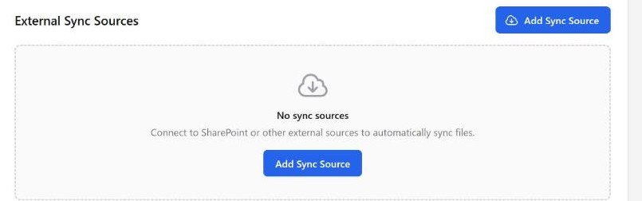

| What you want to update | Use |
| --- | --- |
| A dataset based on a Google Drive file | [Google Drive sync](#sync-a-dataset-from-google-drive) |
| Documents stored in Microsoft 365 | [SharePoint or OneDrive sync](#sync-files-from-sharepoint-or-onedrive) |
| A dataset that already has a data source | [**Sync Now**](#refresh-a-dataset-now) |
| Data you build in Alphacast | [Pipelines](/steps/overview) |

Connecting your own sources depends on your [plan](https://www.alphacast.io/pricing), which also sets how many external connections you can use.

## Sync a dataset from Google Drive

You can use a CSV, XLSX or Google Sheets file.

<Steps>
  <Step title="Start a new dataset">
    Click **Create new**, then **Dataset**.
  </Step>
  <Step title="Connect Google">
    Click **Sign in with Google** and allow access. Then click **Add File from Google Drive** and pick your file.
  </Step>
  <Step title="Configure it">
    Select a sheet if asked, then [set up the columns](/your-data/datasets#create-a-dataset).
  </Step>
  <Step title="Choose a frequency">
    Under **Syncronization**, select **None**, **Hourly**, **Daily** or **Weekly**. Click **Save**.
  </Step>
</Steps>

To change the frequency, open the dataset's **Settings** tab. There you can also show or hide the Google Drive link, or use **Disconnect from Google Drive**. A disconnected dataset stops updating.

Keep the same column structure in the source file. If a sync fails, check that the file still exists and that your Google account can open it. Reconnect your Google account if needed.

## Sync files from SharePoint or OneDrive

This syncs documents into a repository's [Files](/your-data/files) tab. You need **Admin** access to the repository.

<Steps>
  <Step title="Add a source">
    Open the repository's **Settings**. Under **External Sync Sources**, click **Add Sync Source**.
  </Step>
  <Step title="Connect Microsoft 365">
    Click **Connect Microsoft Account** and sign in.
  </Step>
  <Step title="Choose a folder">
    Select **SharePoint** or **OneDrive**, browse to the folder and click **Select This Folder**.
  </Step>
  <Step title="Create the source">
    Enter a **Name** and choose a **Sync Frequency**: **Manual only**, **Every hour**, **Daily** or **Weekly**. Click **Create Sync Source**.
  </Step>
</Steps>

<Frame>
  
</Frame>

From the list, you can run a sync, disable or enable the source, and delete it. You can also turn on **Auto-extract files on sync** to process files for AI search. The list shows the last sync time and any error.

<Warning>
  Deleting a sync source also deletes all the files that it synced into Alphacast.
</Warning>

## Refresh a dataset now

Some datasets show **Sync Now** in their actions. It asks for an update from the data source, or runs the pipeline that fetches external data. The **Versions** tab shows the activity.

Whether you see the button depends on how the dataset is updated and on your access. If the data was synced recently or a run is already waiting, Alphacast may ask you to try again later. A sync does not create new observations if the source has none.

## Next steps

<CardGroup cols={2}>
  <Card title="Follow a dataset" icon="bell" href="/notifications#follow-a-dataset">
    Know when new data arrives.
  </Card>
  <Card title="Pipeline runs" icon="clock-rotate-left" href="/pipelines/runs">
    Check how your pipelines ran.
  </Card>
</CardGroup>
